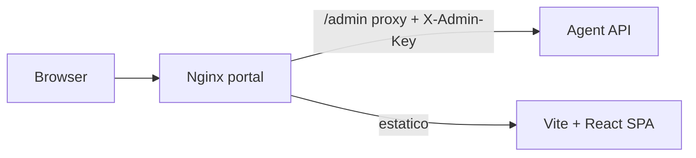

# Arquitetura do portal

Repos separados: **madeplant-agent-portal** (UI) + **madeplant-agent-cloud** (API).

## Camadas

## Perfis (RBAC — UI)

| Perfil | Escopo | Menus |
|--------|--------|-------|
| `super_admin` | Plataforma | Todos + Tenants |
| `tenant_admin` | Um tenant | Estações, usuários, categorias, políticas |
| `manager` | Hierarquia | Summary, timeline, reports (sem screenshots se perfil negar) |
| `viewer` | Leitura | Summary + timeline |

**Lab hoje:** um único `ADMIN_API_KEY` → API não distingue perfil. O portal simula perfil via seletor local (preview de menu). **Produção:** login + JWT/Entra (backlog) e claims na API.

## Rotas (`#/...`)

| Rota | Tela | API hoje |
|------|------|----------|
| `#/login` | Autenticação | Proxy nginx ou chave dev |
| `#/dashboard` | Summary / gráficos | `focus-summary`, `activity-summary` |
| `#/stations` | Estações monitoradas | `GET /admin/v1/devices` |
| `#/stations/:id` | Detalhe da estação | events, focus, activity, screenshots |
| `#/timeline` | Linha do tempo | events |
| `#/screenshots` | Galeria | screenshots |
| `#/activity` | Teclado / mouse | `activity-summary`, `input.activity` |
| `#/workday` | Jornada | *futuro* |
| `#/reports` | Relatórios export | focus-summary + CSV |
| `#/categories` | Categorização apps | *futuro* |
| `#/monitored` | Pessoas / equipes | *futuro* |
| `#/admin/tenant` | Admin do tenant | *futuro* |
| `#/admin/platform` | Super admin | *futuro* |

## Próximos incrementos (Cloud)

- `POST /admin/v1/auth/login` + sessão
- CRUD tenants, users, hierarchy, categories
- Workday rules
- Permissão `screenshots:read` por perfil